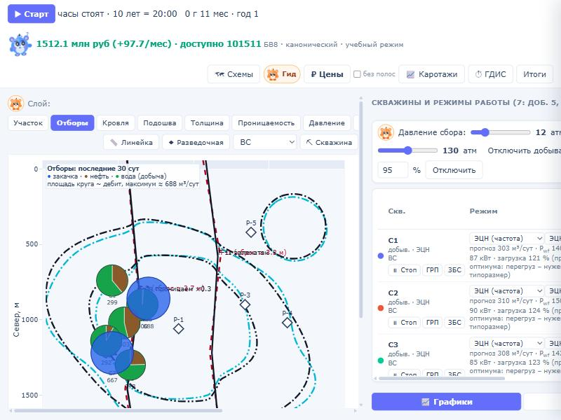
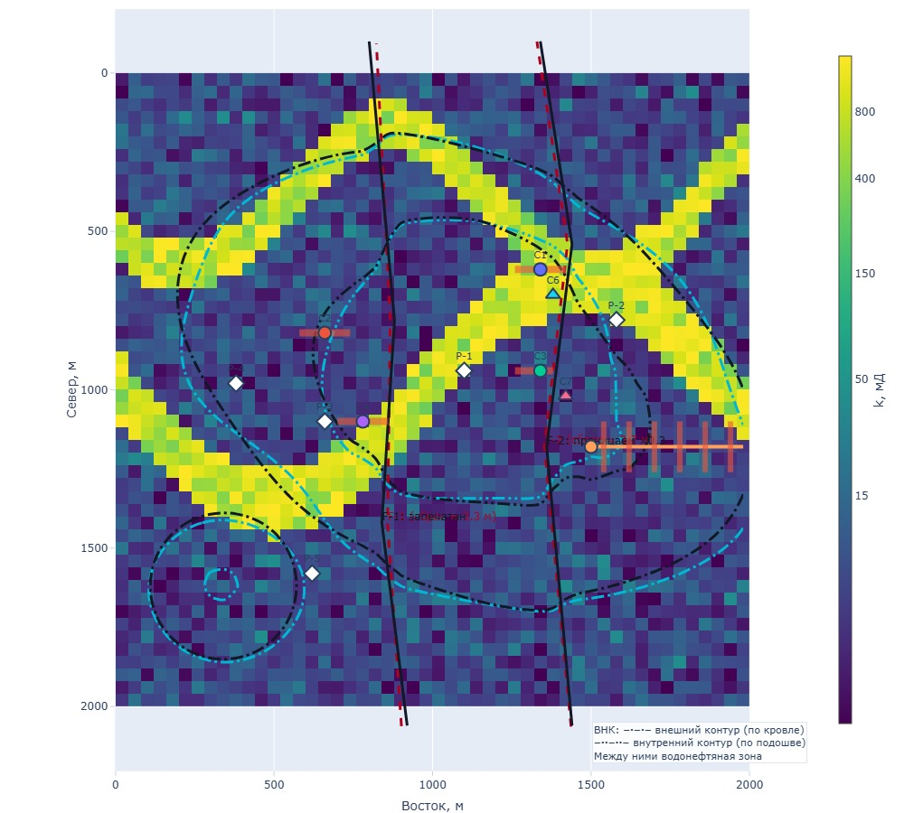
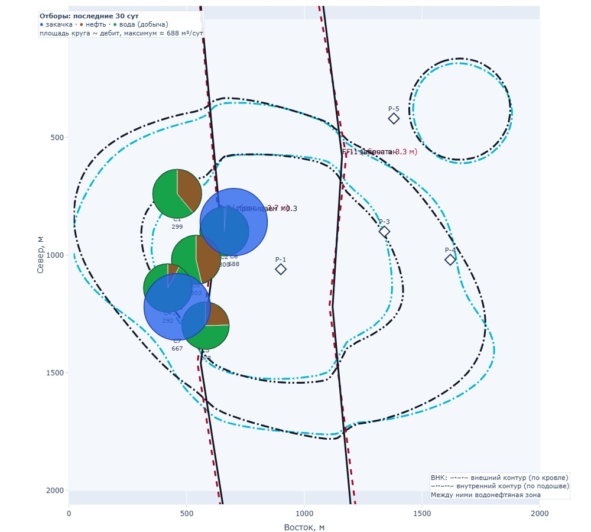
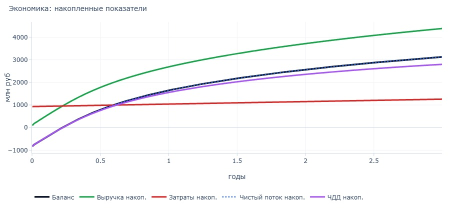
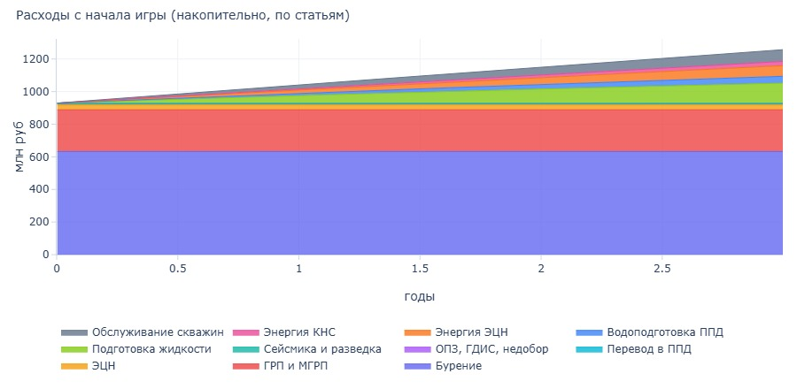
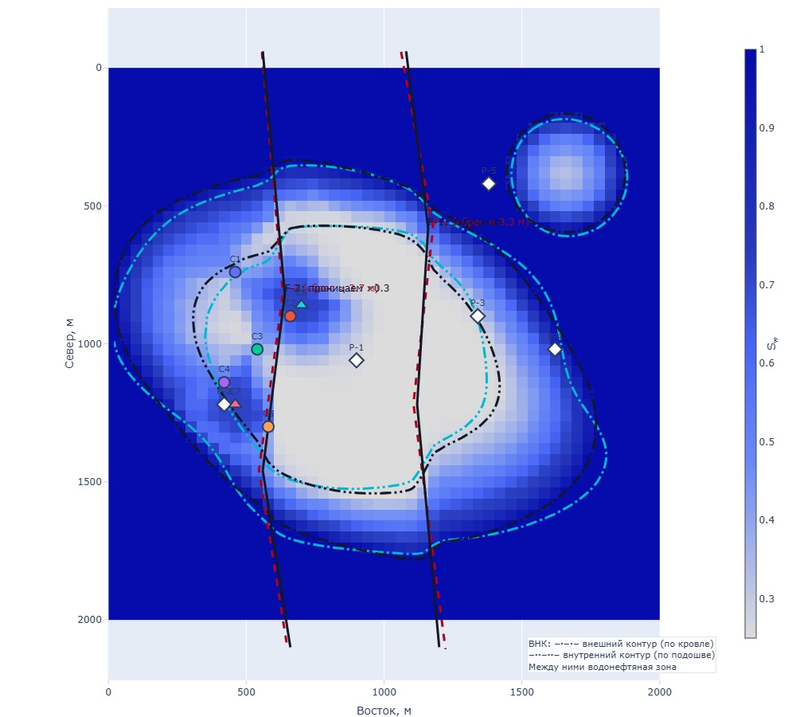
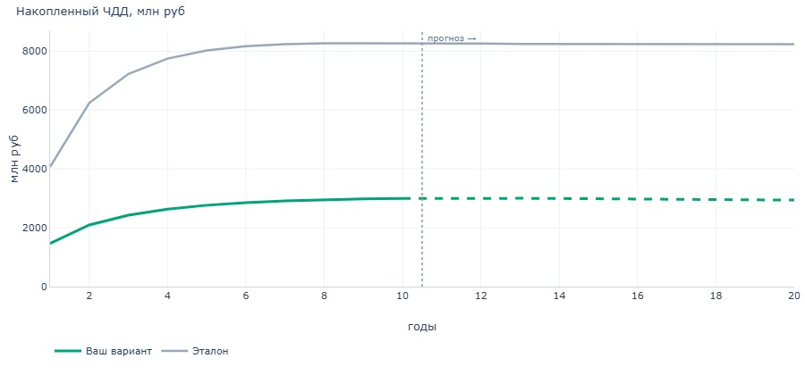

<div align="center">

# 🛢️ Нефтяша

### Учебная игра-симулятор разработки нефтяного месторождения

**Разведка → сейсмика → бурение → закачка воды → деньги → отчёт с оценкой.**<br>
Один HTML-файл, работает в браузере без установки и без сети.

[**▶ Играть онлайн**](https://dmitryvoronin.gitverse.site/neftesim_neftyasha/) · [**📘 Методичка**](https://dmitryvoronin.gitverse.site/neftesim_neftyasha/manual/) ([PDF](https://dmitryvoronin.gitverse.site/neftesim_neftyasha/manual/book/neftyasha-manual.pdf)) · [Как играть](#как-играть) · [Для преподавателя](#для-преподавателя) · [Устройство модели](docs/MODEL.md)



</div>

---

## О чём игра

Вы – инженер-разработчик нового месторождения. Геология скрыта: есть пять разведочных скважин с каротажем, платная
сейсмика, гидродинамические исследования (ГДИС). За 10 лет нужно разбурить залежь, поддерживать давление закачкой воды,
подбирать насосы и режимы – и **добыть больше нефти (КИН) и заработать больше (ЧДД)**. Потом игра рассчитывает ещё 10 лет
прогноза и ставит оценку по сравнению с эталонной разработкой: **эталон = 100 баллов**, превзойти его можно, но очень непросто.

Игра создана для студентов-нефтяников: за 20–40 минут можно прожить жизнь месторождения и увидеть, к чему приводят
решения о размещении скважин, ГРП, режимах насосов и закачке. Подсказывает и подбадривает **Нефтяша**: маленький оранжевый в
гиде и большой синий у счётчика денег (танцует, когда заработок растёт, и плачет, когда долг растёт).

## Что внутри

| | |
|---|---|
| **6 объектов** | БВ8 (Самотлор), АВ1 «рябчик», ЮВ1, ЮК10–11 (Талинская площадь), ачимовка, бобриковский горизонт: свои проницаемость, вязкость, глубина, давление, цены и сложность |
| **Сиды** | любое число создаёт свой объект в диапазонах типа пласта: структура, разломы, ВНК, карты проницаемости и толщин. Один сид у всего класса – один объект и один эталон |
| **Заканчивание** | вертикальные, ГРП, горизонтальные скважины любой длины и азимута, МГРП, боковые стволы |
| **Оборудование** | штуцеры, ЭЦН (16 типоразмеров с характеристиками), КНС, система сбора; конструкция скважины и схемы |
| **Исследования** | каротаж и РИГИС, сейсмика 3D (с ошибками), ГДИС: кривая восстановления давления, k, скин, пластовое давление |
| **Деньги** | цены по аналогам, кредит с лимитом долга, подготовка жидкости, электроэнергия, обслуживание, ЧДД; графики экономики и расходов по статьям |
| **Режимы времени** | по годам или непрерывно: 10 лет за 5–90 минут, изменения на ходу |
| **Отчёт** | оценка с расшифровкой, прогноз на 10 лет, сравнение с эталоном, доходы и затраты, выгрузка в PDF |
| **Расчёт** | двухфазная модель нефть-вода (IMPES), сетка от 25×25 до 100×100, ядро на Rust → WebAssembly |

<table>
<tr>
<td width="50%"><br><sub>Карта проницаемости, разломы, контуры ВНК (штрих-пунктир внешний, с двумя точками внутренний), скважины с ГРП и МГРП</sub></td>
<td width="50%"><br><sub>Карта отборов: синие круги – закачка, коричнево-зелёные – добыча (нефть и вода)</sub></td>
</tr>
<tr>
<td><br><sub>Экономика: баланс, накопленные выручка, затраты, чистый поток и ЧДД</sub></td>
<td><br><sub>Расходы накопительно по статьям, статьи включаются фильтрами</sub></td>
</tr>
<tr>
<td><br><sub>Карта насыщенности: куда идёт вода от нагнетательных</sub></td>
<td><br><sub>Отчёт: накопленный ЧДД против эталона</sub></td>
</tr>
</table>

## Запуск

Игра – один файл [`index.html`](index.html) (плюс локальная копия Plotly в `vendor/`).

- **Онлайн:** https://dmitryvoronin.gitverse.site/neftesim_neftyasha/
- **Локально:** скачайте репозиторий и откройте `index.html` двойным щелчком. Сеть и сервер не нужны.
- **Методичка** (теория, разборы объектов, живой код на ядре игры): https://dmitryvoronin.gitverse.site/neftesim_neftyasha/manual/,
  исходники в [`manual/`](manual/README.md).

## Как играть

1. **Выберите объект** (карточки; при наведении Нефтяша рассказывает о пласте), при желании введите **сид** и режим времени.
   Для первого знакомства отметьте **«Учебный режим»**: геология видна сразу. Нажмите **«Начать разработку»**.
2. **Разведка.** Кликните по ромбикам ◆: каротаж и РИГИС покажут нефть (оранжевая) и воду (синяя). Найдите ВНК и введите его в
   поле «Ваш ВНК»; **сейсмика 3D** добавит карты кровли и подошвы и разломы. Контуры ВНК появятся на карте.
3. **Бурение.** Карту можно приближать колесом мыши, двигать перетаскиванием, двойной щелчок или «⤢ Вся карта» возвращают целую. Выберите заканчивание и нажмите **«⛏ Скважина»**, затем кликните по карте выше ВНК. Цену показывает подсказка кнопки и
   кнопка **«₽ Цены»**. Деньги идут с нуля в кредит до лимита долга.
4. **Управление.** В панели справа задайте режим (фонтан/ЭЦН, частота, насос), переведите часть скважин под закачку (💧→),
   остановите обводнившиеся. Проводите **ГДИС** и **ОПЗ**, делайте **ГРП/МГРП/ЗБС**. Следите за картами «Отборы», «Давление», «Насыщенность»
   и графиками экономики.
5. **Время.** «Рассчитать год» (по годам) или «Старт» (непрерывно). Через 10 лет откроется **отчёт с оценкой** и выгрузкой в PDF.

В игре есть оранжевый **Нефтяша-гид** (кнопка «Гид»): цель, шаги, управление скважинами, деньги, советы по каждому объекту.

## Для преподавателя

- **Соревнование в классе.** Назовите объект и сид (например, «ЮВ1, сид 4821») и попросите всех оставить цены и настройки расчёта по умолчанию.
  Объект и эталон у всех будут одинаковыми, код объекта виден в шапке отчёта; изменённые цены и настройки отчёт помечает как несопоставимые.
- **Сложность** объектов от ★ (БВ8) до ★★★★ (ачимовка). Для знакомства с интерфейсом подойдут БВ8 и учебный режим.
- **Отчёт в PDF** с полем «Участник» удобно сдавать как работу. Оценка: 50 % КИН + 50 % ЧДД, эталон = 100.
- Все цены, лимит долга и горизонт можно менять на стартовом экране, а размер сетки и шаги расчёта – в окне «⚙ Расчёт».

## Разработка

```bash
node tests/selftest.js            # самотест ядра (101 проверка) на JS
node tests/selftest.js --wasm     # то же через Rust/WebAssembly и сверка с JS
```

Ядро расчёта и интерфейс живут в `index.html` (скрипты `#sim-core` и `#app`); решатель на Rust – в [`rust/`](rust/) и встраивается в
файл командой `node rust/embed.mjs` (нужны `rustup` и `wasm-pack`, см. [docs/MODEL.md](docs/MODEL.md#ускоритель-webassembly-rust-ядро)).
Эталоны для объектов ищет [`tools/search-reference.js`](tools/search-reference.js). Подробнее для разработчиков и ИИ-агентов – [AGENTS.md](AGENTS.md).

```
index.html      игра целиком: ядро расчёта, интерфейс, встроенный WebAssembly
vendor/         Plotly (локальная копия, без CDN)
rust/           Rust-ядро (давление, потоки, перенос) → WebAssembly
tests/          самотест физики и экономики
tools/          поиск эталонов
docs/           описание модели (MODEL.md), снимки экрана
```

## Происхождение и лицензия

Игра выросла из учебного прототипа симулятора фильтрации нефти **khabibullinra** (MIT) и существенно переработана: добавлены скрытая геология и
разведка, объекты и сиды, ГДИС, оборудование и экономика, ГС/ГРП/МГРП, режимы времени, отчёт с оценкой и эталонами, ядро на Rust и весь
интерфейс. Нефтяша и тексты игры – оригинальные. Названия месторождений и пластов используются только как географические и геологические аналоги, свойства
пластов приблизительные и учебные, реальных данных недропользователей в игре нет.

Лицензия **MIT**, см. [LICENSE](LICENSE). Графики: [Plotly.js](https://plotly.com/javascript/) (MIT), локальная копия в `vendor/`.
