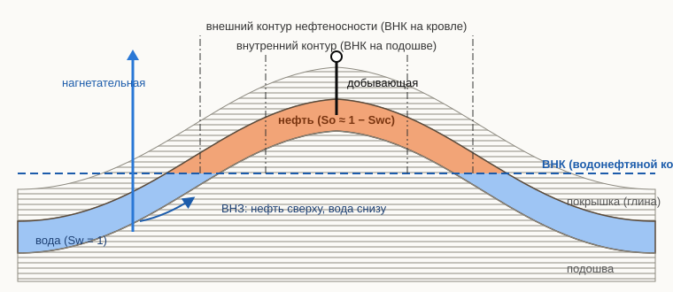

# Месторождение и его разработка с нуля {#sec-field}



Прежде чем бурить в игре, договоримся о словах. В этой главе – минимум геологии и разработки, без которого игра
превращается в лотерею: что такое залежь, откуда берутся запасы, почему падает давление и зачем закачивать воду.

## Залежь: ловушка, коллектор, флюиды

Нефть легче воды и всплывает по пористым породам, пока не упрётся в непроницаемую **покрышку** (глины). Если слой изогнут
куполом – **антиклиналью**, – нефть скапливается в его своде: это **ловушка**. Пористая проницаемая порода, в которой
лежит нефть, – **коллектор** (пласт). Ниже нефти в том же пласте – вода; граница между ними – **водонефтяной контакт (ВНК)**.

{#fig-dome}

На карте залежь ограничена двумя линиями:

- **внешний контур нефтеносности** – где ВНК пересекает **кровлю** пласта: дальше от свода в пласте уже только вода;
- **внутренний контур** – где ВНК пересекает **подошву**: внутри него пласт нефтенасыщен на всю толщину.

Между контурами – **водонефтяная зона (ВНЗ)**: сверху нефть, снизу вода. Скважина в ВНЗ с первого дня даёт нефть с водой.
В игре оба контура рисуются на карте после того, как вы введёте свою оценку ВНК и купите сейсмику (@sec-geology).

Все объекты игры устроены так: **купол с сателлитом** (маленьким куполом рядом), разрезанный **разломами**. У канонических
объектов (сид 0) – одна и та же структура, отражённая зеркально и опущенная на свою глубину; объекты по сиду генерируются
случайно в диапазонах группы.

## Свойства коллектора

| Величина | Обозначение | Единица в игре | Что означает |
|---|---|---|---|
| пористость | $\varphi$ | доли | доля объёма породы, занятая порами (0,16–0,23) |
| проницаемость | $k$ | мД (миллидарси) | насколько легко порода пропускает жидкость; от 0,01 мД (ачимовка) до 2000 мД (русла бобриковского) |
| эффективная толщина | $h$ | м | суммарная толщина проницаемых прослоев (7–15 м) |
| водонасыщенность | $S_w$ | доли | доля пор, занятая водой; нефтенасыщенность $S_o = 1-S_w$ |
| связанная вода | $S_{wc}$ | доли | вода, которая не течёт никогда; в нефтяной части $S_w=S_{wc}$ |
| остаточная нефть | $S_{or}$ | доли | нефть, которую вода вытеснить не может |
| вязкость нефти / воды | $\mu_o,\ \mu_w$ | сП | сопротивление течению; вода ≈ 0,4–1,1 сП, нефть 0,7–22 сП |

Проницаемость в природе распределена **логнормально**: в одном пласте встречаются прослои по 5 и по 500 мД.
В игре у каждого объекта логнормальный фон проницаемости, а у ЮК10–11 и бобриковского – ещё и высокопроницаемые **русла**.

{#fig-mapk .screenshot width=70%}

## Запасы нефти

**Начальные геологические запасы** (OOIP, original oil in place) – это объём нефти в порах:

$$
\text{OOIP}=\sum_{\text{ячейки}} V_p\,(1-S_{w0}),\qquad V_p=\Delta^2\,h\,\varphi .
$$

Пласт в игре двумерный, поэтому разрез в каждой точке **усредняется по вертикали**. Если нефтенасыщенная толщина в
точке $h_н$, а полная $h$, то доля нефтяной части $f_o=h_н/h$ и начальная водонасыщенность ячейки

$$
S_{w0}=f_o\,S_{wc}+(1-f_o)\cdot 1 .
$$

Ниже – настоящая структура учебного купола из ядра игры. Двигайте ВНК и смотрите, как меняются площадь нефтеносности
и запасы: именно поэтому ошибка в ВНК на пару метров – это ошибка в запасах на десятки процентов.

```{ojs}
//| echo: false
viewof owc = Inputs.range([2405, 2440], {value: 2420, step: 0.5, label: "ВНК, абс. отметка (м ниже уровня моря)"})
```

```{ojs}
//| code-fold: true
//| code-summary: "Код: нефтенасыщенная толщина по разрезу каждой ячейки"
dome = neft.field({ scenario: "base" })
domeOil = {
  const r = dome.r, n = r.nx, hOil = new Float64Array(n * n);
  let area = 0, ooip = 0;
  for (let j = 0; j < n; j++) for (let i = 0; i < n; i++) {
    const c = j * n + i, col = core.l2Column(i, j, r.scen, 1);   // разрез: пачки песчаника и глин
    hOil[c] = core.l2OilNet(col, owc);                            // нефть – в песчанике выше ВНК
    const fo = Math.min(1, hOil[c] / (r.h * r.thick[c])), Sw0 = fo * r.Swc + (1 - fo);
    if (hOil[c] > 0) area += r.dx * r.dx;
    ooip += r.poreVol[c] * (1 - Sw0);
  }
  return { hOil, area, ooip };
}
```

```{ojs}
//| echo: false
{
  const r = dome.r, row = 26, prof = [];
  for (let i = 0; i < r.nx; i++) {
    const col = core.l2Column(i, row, r.scen, 1);
    prof.push({ x: (i + 0.5) * r.dx, top: -col[0].top, base: -col.at(-1).base });
  }
  const c = neft.colors();
  const section = neft.Plot.plot({
    width: 440, height: 250, marginLeft: 56, title: "Разрез по строке j = 26 (запад → восток)",
    x: { label: "x, м" }, y: { label: "абс. отметка, м", grid: true },
    marks: [
      neft.Plot.areaY(prof, { x: "x", y1: "base", y2: "top", fill: "#c9b79c", fillOpacity: 0.6 }),
      neft.Plot.areaY(prof, { x: "x", y1: (d) => Math.max(d.base, -owc), y2: (d) => Math.max(d.top, -owc), fill: "#eb6834", fillOpacity: 0.85 }),
      neft.Plot.ruleY([-owc], { stroke: c.s[0], strokeWidth: 2, strokeDasharray: "8,4" }),
      neft.Plot.text([[1950, -owc]], { text: () => "ВНК", dy: -8, textAnchor: "end", fill: c.s[0], fontWeight: 600 }),
    ],
  });
  return html`<div class="neft-kpi">
      <div><b>${(domeOil.area / 1e6).toFixed(2)} км²</b><span>площадь нефтеносности</span></div>
      <div><b>${(domeOil.ooip / 1e6).toFixed(2)} млн м³</b><span>запасы OOIP</span></div>
      <div><b>${(domeOil.ooip * 0.86 / 1e6).toFixed(2)} млн т</b><span>то же в тоннах (ρ = 0,86)</span></div>
    </div>
    <div class="neft-row">
      <div>${neft.map(dome, { layer: "hOil", data: domeOil.hOil, wells: false, domain: [0, 10], title: "Нефтенасыщенная толщина" })}</div>
      <div>${section}</div>
    </div>`;
}
```

Истинный ВНК учебного купола – абс. −2420 м. Обратите внимание на **разломы** (красный пунктир): блок за разломом может
иметь кровлю выше или ниже на 3–4 м (сброс), поэтому контур нефтеносности на разломе «ломается».

## Пластовое давление и энергия пласта

Жидкость в пласте сжата весом вышележащих пород и воды. Начальное **пластовое давление** обычно близко к
гидростатическому: около 0,1 атм на метр глубины. В игре $P_0 = \text{градиент}\times\text{глубина}$ (у ачимовки –
аномально высокое, 0,116 атм/м).

Почему нефть вообще течёт к скважине? Потому что давление в скважине (**забойное**, $P_{wf}$) ниже пластового, а жидкость
течёт от высокого давления к низкому (закон Дарси, @sec-darcy). Откуда пласт берёт энергию, чтобы «выталкивать» нефть?

- **Упругий режим.** Порода и жидкость чуть-чуть сжимаемы ($c_t\approx10^{-4}$ 1/атм). Отобрали объём $\Delta V$ – давление
  упало на $\Delta P=\Delta V/(V_p c_t)$. Запас этой энергии мал: из пласта можно упруго отобрать порядка 1–2 % запасов,
  и давление упадёт на сотню атмосфер.
- **Водонапорный режим.** Если в пласт закачивать воду – **поддержание пластового давления (ППД)**, – давление держится, а
  вода ещё и вытесняет нефть к добывающим. Это основной способ разработки в Западной Сибири и в игре.

::: {.callout-important}
## Главное правило игры

Без закачки давление за год-два падает, дебиты падают вместе с ним, фонтан глохнет, насосы работают на пределе.
**Разработка в игре – это система добывающих и нагнетательных скважин**, а не набор отдельных скважин.
:::

## Системы разработки

Скважины расставляют не как попало, а **сеткой** – по системе. Основные системы, которые перебирает и эталон игры:

| Система | Как устроена | Когда хороша |
|---|---|---|
| рядная | ряды добывающих, между ними ряды нагнетательных | вытянутые залежи, высокая проницаемость |
| пятиточечная (шахматная) | каждая нагнетательная окружена четырьмя добывающими и наоборот, 1 : 1 | средняя и низкая проницаемость, нужно много закачки |
| «две добывающие на одну нагнетательную» | обращённая семиточечная, 2 : 1 | высокая проницаемость, вязкая нефть |

Расстояние между скважинами (**плотность сетки**) – главный экономический выбор: густая сетка быстрее и полнее отбирает
нефть, но каждая скважина стоит 40–95 млн руб. Эталон игры для БВ8, например, обходится **тремя** скважинами, а для
ЮК10–11 – четырнадцатью.

## Коэффициент извлечения нефти (КИН)

Не вся нефть будет добыта. **КИН** – доля запасов, которую удалось извлечь:

$$
\text{КИН}=\frac{Q_{н,\text{накоп}}}{\text{OOIP}}=K_{выт}\cdot K_{охв}.
$$

- **Коэффициент вытеснения** $K_{выт}$ – какую долю нефти вода вымывает там, где прошла. Даже идеальная промывка оставляет
  $S_{or}$, поэтому предел:
  $$K_{выт}^{max}=\frac{1-S_{wc}-S_{or}}{1-S_{wc}} .$$
  Для учебного купола $(1-0{,}2-0{,}25)/(1-0{,}2)=0{,}69$, для «рябчика» АВ1 – всего $(1-0{,}42-0{,}30)/(1-0{,}42)=0{,}48$.
- **Коэффициент охвата** $K_{охв}$ – какую часть пласта вода вообще затронула. Его портят неоднородность (вода бежит по
  руслам), разломы, неудачная расстановка скважин и вязкая нефть.

КИН – половина оценки в игре (@sec-economics). Типичные КИН эталонов – от 26 % (ачимовка) до 50 % (бобриковский).

## Обводнённость и стадии разработки

**Обводнённость** – доля воды в добываемой жидкости: $f=q_в/q_ж$. Когда фронт закачанной воды доходит до добывающей,
обводнённость начинает расти, и дальше нефть добывается всё с большим «балластом» воды, которую надо поднять, подготовить и
закачать обратно. Жизнь месторождения обычно делят на стадии:

1. **Ввод** – бурение, рост добычи.
2. **Полка** – максимальная добыча, обводнённость низкая.
3. **Падение** – прорыв воды, обводнённость растёт, добыча нефти снижается.
4. **Поздняя стадия** – обводнённость 90–98 %, скважины на грани рентабельности; часть отключают.

Игра длится 10 лет, а оценка считается за 20 (10 лет факта + 10 лет прогноза при неизменном фонде). Поэтому важно не
только «снять сливки» в первые годы, но и оставить месторождение в рабочем состоянии.

{#fig-sat .screenshot width=70%}

## Вопросы для самопроверки

1. Чем внешний контур нефтеносности отличается от внутреннего? Где выгоднее бурить добывающую?
2. В виджете поднимите ВНК на 5 м (−2415). Во сколько раз изменились запасы? Почему так сильно?
3. Посчитайте предел вытеснения для БВ8 ($S_{wc}=0{,}25$, $S_{or}=0{,}28$). Может ли КИН в игре оказаться выше?
4. Почему без закачки давление падает быстро, хотя пласт огромный?
